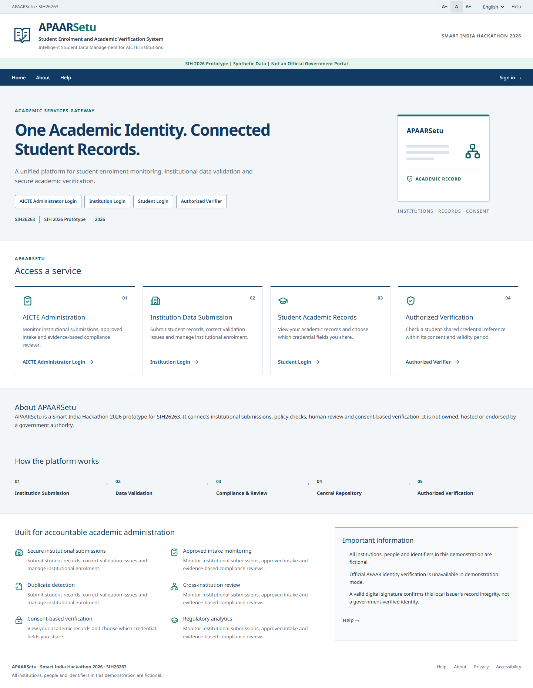
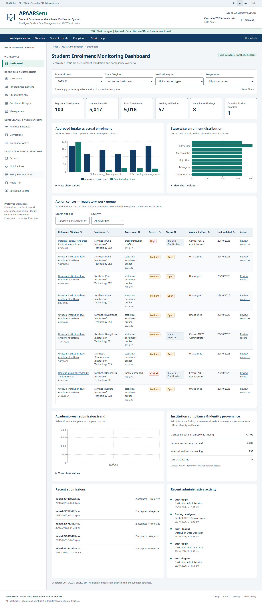
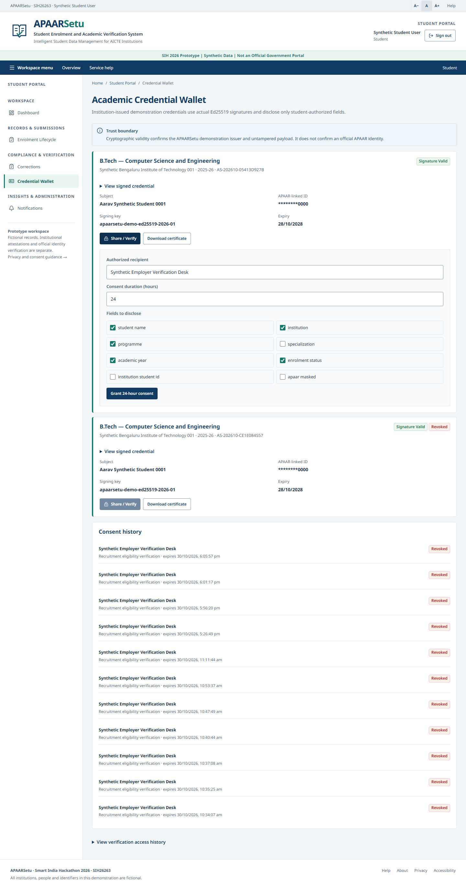

# APAARSetu

**Intelligent Student Data Management, Enrolment Compliance and Academic Verification Platform**

Smart India Hackathon 2026 project for **SIH26263**. APAARSetu connects institutional student submissions, approved-intake monitoring, evidence-based discrepancy review and student-controlled credential sharing in one working application.

**Live demonstration: [sih-apaarsetu.vercel.app](https://sih-apaarsetu.vercel.app/)**

The complete Next.js/FastAPI application runs on Vercel with persistent Neon PostgreSQL. Use the [demo accounts](#demonstration-accounts) below. [Hosted verification results](docs/HOSTED_DEMO_RESULTS.md) record the public browser and database checks completed on 30 October 2026.

> **Prototype status:** All demonstration people, institutions and identifiers are fictional. Official APAAR, DigiLocker and AICTE provider connections are unavailable. Identifier format checks and locally signed demonstration credentials do not establish official identity verification. The project does not issue official APAAR IDs or claim government affiliation.

[Quick start](#quick-start-windows) · [Features](#features) · [Architecture](#architecture) · [Testing](#testing-and-verification) · [Documentation](#documentation) · [SIH material](#sih-submission-and-demo-material)

## Application preview

### Public service gateway



### Student enrolment monitoring dashboard



### Student credential wallet



Additional desktop, laptop, tablet and mobile captures are available in [the screenshot directory](docs/screenshots/ui-redesign).

## What the project addresses

Institutions submit student records in different formats. Reviewing those records against programme approvals, tracking corrections and investigating overlapping enrolments requires consistent data and a traceable decision process. Students also need a way to disclose only the academic information required by a verifier.

APAARSetu maintains student identity separately from institutional enrolment, links compliance findings to their evidence and records subsequent review actions. Its four portals share the same backend and persistent relational records.

## Features

| Area | Implemented capability |
|---|---|
| Institution and programme management | Scoped registries, programme records, academic years and approved intake |
| Student management | Masked identifiers, academic case files, enrolment history and correction requests |
| Bulk submissions | CSV/XLSX upload, column mapping, preview, row validation, explicit review and submission receipts |
| Intake compliance | Programme/year comparisons with versioned policies and separate regular/supernumerary treatment |
| Discrepancy review | Duplicate and overlapping-enrolment checks, evidence comparison, reviewer assignment and justified decisions |
| Statistical detection | Isolation Forest signals for unusual institution-level numerical patterns |
| Credentials | Ed25519-signed demonstration credentials, validity periods, PDF certificates and revocation |
| Student consent | Selected-field disclosure, expiring opaque references, QR access and consent revocation |
| Reporting | 18 report types, supported filters, reconciliation, CSV and PDF exports |
| Operational records | Notifications, audit trails, record versions and on-demand maintenance actions |
| Demonstration | Five interactive scenarios that call real application services and retain scenario progress |

NRI admission category, OCI status and Foreign National status remain independent attributes. A flagged conflict is a request for review, not an automatic finding of fraud.

### Portals and permissions

| Portal | Intended users | Main tasks |
|---|---|---|
| Administrative | Central administrator, regional officer, auditor | Monitor enrolment, inspect findings, review records and access authorized reports |
| Institution | Institution administrator and operator | Maintain scoped records, submit imports and handle corrections; credential issuance requires an authorized role |
| Student | Individual student | View own records, request corrections and manage credential disclosure |
| Verifier | Authorized reference holder | Open a shared reference and check its permitted fields, signature and current consent |

The login role selector fills the relevant demonstration account. The backend decides permissions from the authenticated account. Regional, institution and student boundaries are enforced server-side; verifier access does not provide unrestricted student lookup.

### Interface and accessibility

- Government-style navy/teal interface with a shared masthead, breadcrumbs, grouped navigation and responsive tables.
- Desktop, laptop, tablet and mobile layouts, with keyboard navigation and visible focus states.
- Local English/Hindi translations for public, sign-in, guidance and verification screens. Protected workspaces remain English.
- Persisted text-size and language preferences, reduced-motion support and print styling.
- Original application branding and explicit prototype notices.

Automated accessibility results are documented below. They do not constitute formal WCAG or GIGW certification.

## Quick start (Windows)

For cloud hosting, see [Vercel and Neon deployment](docs/DEPLOYMENT_VERCEL.md). The repository includes a two-service Vercel configuration, PostgreSQL support, explicit cloud initialization and stable environment-backed signing keys. Hosted uploads use a 3 MB limit; the local default remains 10 MB.

### Prerequisites

- Windows with PowerShell and Git.
- **Python 3.12**, installed at `%LOCALAPPDATA%\Programs\Python\Python312\python.exe`, which is the path expected by the setup script. If Python is elsewhere, adjust `scripts/setup.ps1` before running it.
- **Node.js 22** with `node.exe` and `npm.cmd` on `PATH`.
- An internet connection for the first dependency installation.
- Brave is optional for browsing, but the supplied browser tests use an installed Brave/Chromium executable.

Docker and paid AI services are not required. Native Windows execution is the verified configuration.

### 1. Clone and install

```powershell
git clone https://github.com/Vatsal212005/SIH-APAARSetu.git
Set-Location SIH-APAARSetu
powershell.exe -NoProfile -ExecutionPolicy Bypass -File .\scripts\setup.ps1
```

Setup creates a project-local Python virtual environment, installs backend requirements and installs frontend dependencies from `package-lock.json` using `npm ci --legacy-peer-deps`.

### 2. Start the synthetic demonstration

```powershell
powershell.exe -NoProfile -ExecutionPolicy Bypass -File .\start-dev.ps1 -Demo -OpenBrave
```

| Service | Local address |
|---|---|
| Frontend | http://localhost:3001 |
| Interactive API documentation | http://localhost:8001/docs |
| Backend health | http://127.0.0.1:8001/health |

The launcher applies additive Alembic migrations, seeds demonstration data idempotently when `-Demo` is supplied, and waits for the services to become healthy. The application generates its persistent local secret and issuer material as needed under `runtime/`.

`-OpenBrave` opens Brave when it exists at the configured standard installation path. Otherwise, open the frontend address in your browser. Development services bind to the local machine.

### 3. Stop owned services

```powershell
powershell.exe -NoProfile -ExecutionPolicy Bypass -File .\stop-dev.ps1
```

The scripts track project-owned processes. Occupied ports are reported without stopping unrelated services. Preserve `runtime/` to keep the local database, application secret and signing keys across restarts.

## Demonstration accounts

**Development-only password for every account below:** `Demo@26263`

These are intentionally public synthetic demo credentials. The backend rejects demo accounts unless `APAARSETU_DEMO_MODE=true`; launching with `-Demo` enables that setting for the local demonstration.

| Role | Email |
|---|---|
| Central administrator | `central.admin@apaarsetu.demo` |
| Southern regional officer | `regional.officer@apaarsetu.demo` |
| Institution administrator | `institution.admin@apaarsetu.demo` |
| Institution operator | `institution.operator@apaarsetu.demo` |
| Student | `student@apaarsetu.demo` |
| Verifier | `verifier@apaarsetu.demo` |
| Auditor | `auditor@apaarsetu.demo` |

## Suggested demonstration

1. Sign in as the central administrator and inspect year-filtered dashboard totals, institutions and approved intake.
2. Open the **Demo Centre** and run an intake scenario: authorized capacity **120**, counted enrolments **135**, excess **15**.
3. Compare the cross-institution records and record a review with justification.
4. Sign in as an institution operator and preview the bundled [mixed student CSV](frontend/public/student-import-mixed.csv). Inspect errors before confirming eligible rows.
5. Sign in as a student, share selected credential fields, open the verifier reference, revoke consent and show that subsequent access is denied.

The five Demo Centre scenarios cover intake excess, cross-institution overlap, student-controlled verification, mixed-file validation and statistical anomalies. The central presentation scenario explicitly scripts consent for a fictional student; ordinary administrators do not receive general authority to consent on a student's behalf.

See the [complete demo guide](docs/COMPLETE_DEMO_GUIDE.md), [scenario instructions](docs/SIH_DEMO_GUIDE.md) and [three-minute script](docs/SIH_3_MINUTE_DEMO.md).

## Architecture

| Layer | Technology and responsibility |
|---|---|
| Web application | Next.js App Router, React, strict TypeScript and Tailwind CSS |
| Interface/data tools | TanStack Query/Table, React Hook Form, Zod, Recharts and Lucide |
| API | Python 3.12, FastAPI and Pydantic; versioned routes under `/api/v1` |
| Persistence | SQLAlchemy 2, Alembic migrations and SQLite with foreign keys/WAL |
| Imports | pandas and openpyxl for CSV/XLSX ingestion |
| Detection | Deterministic validation/compliance rules and scikit-learn Isolation Forest |
| Credentials | `cryptography` Ed25519 signatures, opaque disclosure references, QR codes and ReportLab PDFs |
| Quality | pytest, Vitest, Testing Library, Playwright, axe, TypeScript, ESLint and Ruff |

### Data flow

1. A portal sends a request to FastAPI with the authenticated session and, for mutations, a CSRF header.
2. Backend dependencies check the role and permitted institution/region/record scope.
3. Services validate inputs, execute database transactions and create relevant audit/version records.
4. Deterministic checks and statistical signals attach evidence to findings for human review.
5. Credential verification checks the signed payload and current expiry, revocation and consent state before disclosing allowed fields.

Student identity, enrolment, programme approval, import batch, finding, credential and consent are separate records. The UI uses live backend projections rather than fabricated dashboard values. Provider interfaces represent external identity evidence and currently report official verification as unavailable.

Read [architecture](docs/ARCHITECTURE.md), [database design](docs/DATABASE_DESIGN.md), [API documentation](docs/API.md) and the [page/API map](docs/UI_PAGE_MAP.md).

## Repository structure

```text
backend/
  app/api/             Authentication, operations, reporting and workspace routes
  app/services/        Validation, import, compliance, credential and demo services
  app/integrations/    External identity-provider boundary
  alembic/             Additive database migrations
  tests/               Backend regression and authorization tests
frontend/
  app/                 Public pages, role workspaces and verification routes
  components/          Shared shell, controls, tables and portal components
  features/            Imports, credentials, management and other workflows
  lib/                 API client, types, locale and shared helpers
  tests/               Frontend unit/component tests
  e2e/                 Live browser workflow and redesign tests
demo-data/evaluation/  Synthetic training and labelled hold-out data
docs/                  User, technical, evaluation and SIH documentation
  screenshots/         Actual application captures
  presentation/        Six-slide draft PPTX and PDF
scripts/               Setup, initialization, evaluation and private backup tools
start-dev.ps1          Native Windows launcher
stop-dev.ps1           Owned-process shutdown
.env.example           Configuration reference without real credentials
runtime/               Generated locally; excluded from Git
```

## Configuration

The backend reads `APAARSETU_` settings from process environment variables and an optional root `.env`. A local `.env` is not required for the standard quick start. [.env.example](.env.example) documents available example values; replace its sample secret before using a copied configuration.

| Setting | Default / purpose |
|---|---|
| `APAARSETU_ENV` | `development`; production enables Secure session cookies |
| `APAARSETU_DEMO_MODE` | `false`; `-Demo` enables the synthetic demonstration |
| `APAARSETU_DATABASE_URL` | Project-local `runtime/apaarsetu.db` using SQLite |
| `APAARSETU_SECRET_KEY` | If absent, generate and persist a random secret in `runtime/application.secret` |
| `APAARSETU_SESSION_HOURS` | `8` |
| `APAARSETU_FRONTEND_ORIGIN` | `http://localhost:3001` for credentialed browser requests |
| `APAARSETU_CERTIFICATE_FULL_IDENTIFIER` | `false`; avoid full identifier disclosure in certificates |
| `NEXT_PUBLIC_API_URL` | Frontend setting; defaults to `http://localhost:8001/api/v1` |
| `BRAVE_PATH` | Optional executable override for the Playwright configuration |

Frontend overrides can go in `frontend/.env.local`. Values prefixed `NEXT_PUBLIC_` are browser-visible and must never contain secrets. Set any production origin/API overrides consistently and rebuild the frontend as required.

## Synthetic data and persistence

The deterministic base seed contains:

- **100** fictional institutions and **300** programmes.
- **900** programme/year intake approvals.
- **5,000** fictional student identities and **5,001** current-year enrolments.
- One deliberate cross-institution overlap for review.

The verified local dataset also contains **1,000 historical enrolments** added during recovery without duplicating identities. Subsequent browser demonstrations add labelled synthetic admissions, credentials and review events, so a running instance can have more records than the base seed. The private exercised database is not published; a fresh clone creates its own runtime data.

[Persistence evidence](docs/persistence-check.json) records matching counts before and after an owned-service restart. Synthetic evaluation CSVs are included; databases, issuer keys, session material and runtime backups are excluded.

To create a coherent **private local backup** after initializing the application:

```powershell
.\.venv\Scripts\python.exe scripts\backup_runtime.py
```

This stores a SQLite backup, application secret and issuer keys under ignored `runtime/backups/`. Keep those files private and preserve them together; never upload the backup to a public repository.

## Testing and verification

The following results were recorded during acceptance on **29 October 2026**. They are local executed results, not GitHub Actions status or a claim that every platform has been tested.

| Check | Recorded result |
|---|---|
| Backend regression | **101 passed** |
| Frontend unit/component tests | **12 passed** |
| Live Brave end-to-end journeys | **16 passed** |
| Automated accessibility | **33 named page/state scans, zero reported violations** for the configured WCAG A/AA tags |
| Strict TypeScript | Passed |
| ESLint and Ruff | Passed |
| Next.js production build | Passed |
| Restart persistence | Matching before/after counts |

See [current acceptance results](docs/UI_REDESIGN_TEST_RESULTS.md), [accessibility scope and manual limits](docs/UI_ACCESSIBILITY_RESULTS.md), [backend JUnit evidence](docs/ui-final-backend.xml) and [axe results](docs/ui-accessibility.json).

### Run backend checks from the repository root

```powershell
.\.venv\Scripts\python.exe -m pytest backend -q
.\.venv\Scripts\python.exe -m ruff check backend scripts
.\.venv\Scripts\python.exe scripts\evaluate.py
```

### Run frontend checks

```powershell
Set-Location frontend
npm.cmd test
npm.cmd run lint
npm.cmd run build
npm.cmd run typecheck
```

Run the build and typecheck sequentially with development services stopped; simultaneous dev/build generation can conflict in `.next`. Start the services again before browser tests.

### Run live browser journeys

With the frontend/backend running in demo mode, execute from `frontend/`:

```powershell
# Set only if Brave is installed somewhere other than the configured default.
$env:BRAVE_PATH = 'C:\Program Files\BraveSoftware\Brave-Browser\Application\brave.exe'
npm.cmd run test:e2e
```

Tests use live APIs rather than intercepted response fixtures. They create and modify synthetic demonstration records. Use a dedicated local demonstration instance. The generated HTML report remains in ignored `frontend/playwright-report/`.

### Detection evaluation

The recorded Isolation Forest evaluation uses **500 synthetic training rows** and **240 labelled synthetic hold-out rows**: precision **0.80**, recall **1.00**, F1 **0.889**, with 40 true positives and 10 false positives. These results describe the supplied synthetic distribution, not real-world detection accuracy. Separate deterministic checks use much smaller labelled case sets.

See [evaluation output](docs/evaluation.json) and [anomaly engine documentation](docs/ANOMALY_ENGINE.md) for confusion matrices, timings and limitations.

## Security and privacy

- Opaque session cookies use HttpOnly and SameSite settings; mutation requests require CSRF headers.
- Passwords use salted scrypt. Session/token values are stored as hashes where applicable.
- Identifiers use Fernet encryption and keyed HMAC lookup; routine displays show masked values.
- Sensitive actions require backend role and record-scope checks.
- Signed credentials protect payload integrity; verification also checks live consent and revocation.
- Uploads have format, byte, row and XLSX expansion limits. No uploaded file is executed.
- Verification responses use restrictive cache/referrer policies; native API access logs are disabled to avoid logging disclosure references.
- Secrets, private keys, databases, logs, dependencies, caches and recovery archives are excluded from source control.

Sharing references are bearer links: a recipient can forward one until it expires or is revoked. A recipient label does not cryptographically authenticate the recipient. Local key files rely on operating-system permissions; HSM custody and automated multi-key rotation are not implemented. Audit records resist ordinary application edits but are not tamper-proof against a database administrator.

Read [security and privacy](docs/SECURITY_AND_PRIVACY.md), [consent and verification](docs/CONSENT_AND_VERIFICATION.md) and [credential signatures](docs/CREDENTIAL_SIGNATURES.md).

## Deployment boundaries

This repository provides a verified local demonstration. Before a production deployment, assess and implement:

- Authorized APAAR/DigiLocker/AICTE integrations and appropriate data-sharing permissions.
- HTTPS, managed secret/key custody, backups and recovery procedures.
- A production database and shared rate-limiting/session infrastructure as appropriate.
- Load testing, independent security assessment and applicable privacy/retention requirements.
- Recipient authentication if disclosure must bind access to a specific person or organization.

The original 29 October acceptance run used SQLite. The 30 October hosted deployment verifies PostgreSQL through live workflows, as recorded in [hosted results](docs/HOSTED_DEMO_RESULTS.md). National-scale operation, independent penetration testing and formal accessibility/legal certification are not claimed. Public Hindi coverage does not imply Hindi translations throughout protected workspaces. Table sorting applies to the loaded page; server-side search/filtering/paging covers the complete authorized register.

## Troubleshooting

| Symptom | Action |
|---|---|
| Python not found by setup | Install Python 3.12 in the expected user path or update the setup script's path |
| Frontend dependencies missing | Run `npm.cmd ci --legacy-peer-deps` inside `frontend/` |
| Port 3001 or 8001 occupied | Stop the process you own using that port or resolve the conflict; the launcher does not kill unrelated processes |
| Partial launch or service exit | Inspect `runtime/backend.err.log` and `runtime/frontend.err.log`, then use `stop-dev.ps1` before restarting |
| PowerShell health request to localhost hangs | Probe `http://127.0.0.1:8001/health`; use the documented localhost origin for the normal browser session |
| Demo sign-in rejected | Restart with `-Demo`; demo accounts require demo mode |
| Stale generated frontend output | Stop owned services before rebuilding; preserve the database and keys |
| Shared verifier link denied | Check expiry, consent and credential revocation; create a new sharing grant when appropriate |

Do not copy `node_modules` or `.venv` between machines. Install dependencies locally. Never delete the database to resolve a frontend cache problem.

## Documentation

| Topic | Documents |
|---|---|
| Start and use | [Installation](docs/INSTALLATION.md), [complete user guide](docs/COMPLETE_USER_GUIDE.md), [features](docs/FEATURES.md) |
| Technical design | [Architecture](docs/ARCHITECTURE.md), [database](docs/DATABASE_DESIGN.md), [API](docs/API.md) |
| Data quality | [Validation](docs/VALIDATION_ENGINE.md), [intake compliance](docs/INTAKE_COMPLIANCE.md), [anomaly detection](docs/ANOMALY_DETECTION.md) |
| Trust and disclosure | [Credentials](docs/CREDENTIAL_VERIFICATION.md), [consent](docs/CONSENT_AND_VERIFICATION.md), [official identity limits](docs/IDENTITY_AND_APAAR_LIMITATIONS.md) |
| Interface | [Design system](docs/UI_DESIGN_SYSTEM.md), [page map](docs/UI_PAGE_MAP.md), [accessibility](docs/UI_ACCESSIBILITY_RESULTS.md) |
| Evidence | [Current test results](docs/UI_REDESIGN_TEST_RESULTS.md), [synthetic dataset](docs/SYNTHETIC_DATASET.md), [evaluation](docs/evaluation.json), [persistence](docs/persistence-check.json) |
| Boundaries | [Known limitations](docs/KNOWN_LIMITATIONS.md), [integrations](docs/INTEGRATIONS.md), [security](docs/SECURITY_AND_PRIVACY.md) |

Earlier handoff/test documents preserve the original delivery context. The current frontend acceptance record is `docs/UI_REDESIGN_TEST_RESULTS.md`.

## SIH submission and demo material

- [Idea title](docs/SIH_IDEA_TITLE.txt), [abstract](docs/SIH_ABSTRACT.txt) and [idea description](docs/SIH_IDEA_DESCRIPTION.txt).
- [Innovation points](docs/SIH_INNOVATION_POINTS.txt), [feasibility](docs/SIH_FEASIBILITY.txt) and [impact](docs/SIH_IMPACT.txt).
- [Six-slide content outline](docs/SIH_PRESENTATION_CONTENT.md).
- [Editable six-slide draft PPTX](docs/presentation/APAARSetu-SIH-draft.pptx) and [draft PDF](docs/presentation/APAARSetu-SIH-draft.pdf).
- [Three-minute demo](docs/SIH_3_MINUTE_DEMO.md), [video script](docs/SIH_VIDEO_SCRIPT.txt) and [judge questions](docs/SIH_JUDGE_QA.md).

The presentation files are project drafts, not an official SIH template. Apply the current portal template and enter the exact registered problem title, theme, team ID and team name before submission. Slides must retain the distinction between implemented prototype functionality, synthetic evaluation and proposed official integration.

## References

- [Official APAAR FAQs](https://apaar.education.gov.in/faqs)
- [AICTE Approval Process Handbook 2024–2027](https://aicte.gov.in/sites/default/files/APH%20Final.pdf)
- [scikit-learn Isolation Forest](https://scikit-learn.org/stable/modules/generated/sklearn.ensemble.IsolationForest.html)
- [Ed25519 signing and verification](https://cryptography.io/en/latest/hazmat/primitives/asymmetric/ed25519/)
- [FastAPI](https://fastapi.tiangolo.com/) and [SQLAlchemy](https://docs.sqlalchemy.org/)

## Contributions and licensing

For changes, describe the affected workflow and run the relevant checks above. Use fictional records in issues, screenshots and test fixtures. Never attach runtime databases, secrets, private signing material or active sharing references.

No open-source license is currently included. Public availability alone does not grant a license to redistribute or reuse the project; obtain permission from the repository owner.
